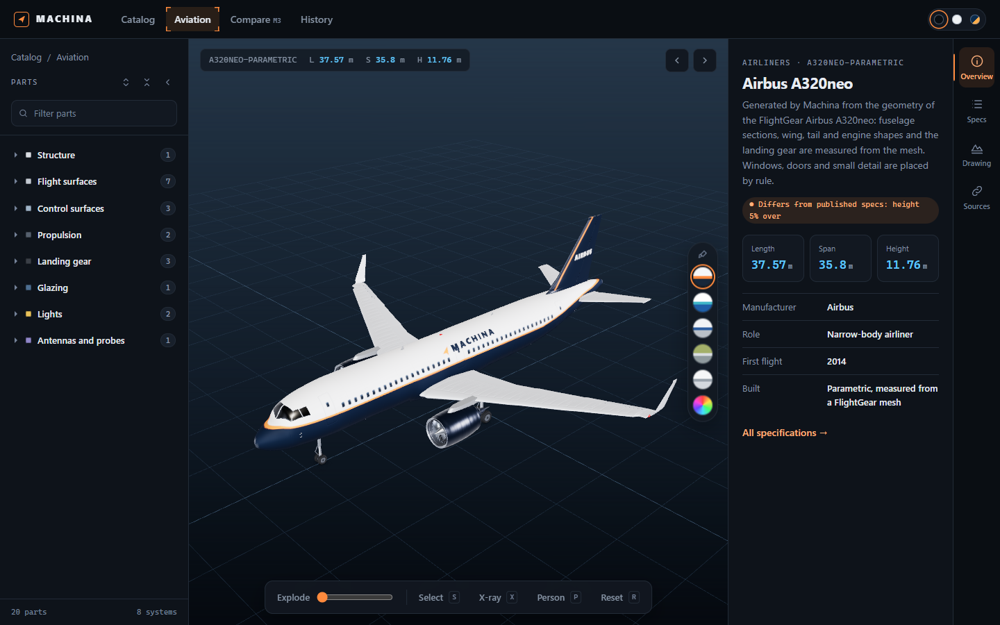

# Machina

**Real aircraft in the browser, every part selectable, every size checked against published specs.**

Machina is a 3D explorer for aircraft. Open a model, click a wing, an engine or a landing gear leg, explode it into parts, see through it in X-ray, and stand a 1.8 m person next to it for scale. Each model is a JSON file of real specs plus open-licensed geometry from the FlightGear community, and a test fails if the model drifts from its published length, span or height.



## The Problem

Good open 3D aircraft exist, but they are locked inside flight simulators: thousands of meshes with names like `Cylinder.042`, scattered across sub-models, offsets and rotations in XML. Model viewers show a single blob. Spec pages show numbers with no shape. Nothing lets you point at a part and ask what it is, or compare two aircraft at true scale.

## The Solution

Machina turns simulator models into explorable, named parts.

| What you get | How |
|---|---|
| **Named, selectable parts** | Rules in each model file map raw meshes to parts (left aileron, slats and Krueger flaps, main gear) grouped by system |
| **True scale** | Every model is measured against its published length, span and height, and any gap is shown on the model page |
| **Three-view drawings** | An A3 sheet per model at a standard scale: side, front and top views projected from the geometry with hidden lines removed, fuselage sections, dimensions and a title block |
| **Generated detail** | Parametric models get panel seams, framed windows, control surface gaps, fan blades, gear linkage, antennas and beacons from the data they already have |
| **Liveries** | Every parametric model can wear Machina's colors, a factory demonstrator scheme, polished metal, factory primer or plain white. Presets swap colors only, so positions stay measured (`#/m/<id>?livery=metal`) |
| **Inside and outside** | X-ray view, exploded view, cabins and cockpits where the source has them |
| **Legal to reuse** | Every asset folder carries its original license and credits, and the tests fail without them |
| **No build step** | Static ES modules and vendored Three.js. Clone, start, open |

## Aircraft

| Group | Models |
|---|---|
| Light aircraft | Cessna 337 Skymaster, Cessna 172S, Robin DR400, Ercoupe 415-C, Piper J-3 Cub |
| Helicopters | Eurocopter EC130 B4 |
| Historic | 1903 Wright Flyer |

In the workshop, waiting for their cockpits or cabins: Airbus A380-800, Boeing 747-400, Boeing 787-8, Boeing 707-320B, Airbus A320neo, Boeing 737-300, DHC-6 Twin Otter, Eurocopter EC135.

Liveries are manufacturer house colors or Machina's own. No airline branding.

## Quality Standard

A model is listed only when it passes every check in [`src/quality.js`](src/quality.js). `npm test` enforces it for listed models, and `npm run quality` reports every model, listed or not.

| Check | Rule |
|---|---|
| Geometry | At least 12,000 triangles |
| Paint | At least 50% of the opaque surface textured, at most 15% plain untextured white |
| Landing gear | At most 25% plain untextured white |
| Interior | A modelled cabin or cockpit, at least 1,500 triangles of seats, panel and controls |
| Parts | At least 10 named parts, left and right parts on the correct side |
| Size | Within the stated tolerance of the published length, span and height |
| License | `LICENSE` and `CREDITS.md` in the asset folder |

A model can relax a rule only with a written reason in its file, for example the Wright Flyer, which has no cabin. Models that do not pass stay in `data/index.json` under `workshop` until they do.

## How It Works

```
FlightGear aircraft (.ac files, GPL)
   │  scripts/import-fg.js  copies meshes, textures and the license
   ▼
assets/aircraft/<id>/       LICENSE, CREDITS.md, Models/
   │
data/models/aviation/<id>.json   specs, sources, placement, part rules
   │
   ▼
browser   AC3D parser in a Web Worker → named parts → Three.js scene
```

A model file holds:

- `specs`: manufacturer, first flight, length, span, height, weights, engines, seats
- `asset.files`: which `.ac` files to load and where to place them, using FlightGear's own offsets
- `asset.parts`: rules that match mesh names to parts and systems, with split rules for repeated parts (left and right, engine 1 to 4)
- `verify`: allowed tolerance against the published size, with a note when the source model differs

## Quick Start

```bash
# Prerequisites: Node 22+
git clone <this repository> machina
cd machina
npm start          # http://127.0.0.1:15420
```

No `npm install` is needed. The server and tests use Node built-ins only.

| Keys | Action |
|---|---|
| Click | Select a part (with the Select tool on, or from the part tree) |
| E | Explode |
| S | Select tool: click parts in the view (off by default) |
| X | X-ray |
| P | Scale figure |
| R | Reset view |
| Esc | Clear selection |

URL flags: `?theme=light` or `?theme=blueprint`, `?noworker` (parse on the main thread). Deep links: `#/m/<id>?part=<part>&xray=1&person=1`.

## Adding an Aircraft

1. Pick a FlightGear aircraft with a clear open license (GPL, CC0 or CC-BY). Download it from the [FlightGear mirror](https://mirrors.ibiblio.org/flightgear/ftp/Aircraft-2020/).
2. Copy the exterior files: `node scripts/import-fg.js <aircraftRoot> aircraft/<id> Models/<file>.ac`
3. Write `CREDITS.md` in the asset folder with source, authors and any changes.
4. Write `data/models/aviation/<id>.json` and list it in `data/index.json`.
5. Map meshes to parts. `npm run inspect -- data/models/aviation/<id>.json` lists every mesh and what it matched.
6. Run `npm run quality`, then `npm test`. The model must meet the quality standard before it goes in the `models` list.

## Limits

- Accuracy follows the source model. Gaps above 1% are listed on the model page, not hidden.
- Part mapping is by mesh name, so some parts group several real components (for example "flap track fairings").
- Generated detail (antennas, probes, panel seams, rib lines) is placed by rule from the body and wing data, not measured from the real aircraft.
- Animations from the simulator data (flaps, gear, rotors) are not played yet.
- Models are large (5 to 30 MB with textures). Textures are capped at 2048 px.

## Tech Stack

| Tool | Purpose |
|------|---------|
| Three.js r170 | Rendering, vendored, the only dependency |
| Plain ES modules and an import map | App, no build step |
| Web Worker | AC3D parsing off the main thread |
| Node.js 22+ | Static dev server and tests, built-in modules only |
| node:test | Model, size, side and license tests |

## Development

```bash
npm test                                              # every model: license, parts, sides, size
npm run quality                                       # every model against the quality standard
npm run drawings [id ...]                             # A3 three-view drawings (SVG) into drawings/
npm run measure                                       # measured size of every model against the specs
npm run inspect -- data/models/aviation/<id>.json     # meshes and the parts they map to
```

See [VISION.md](VISION.md) for the direction and [ROADMAP.md](ROADMAP.md) for weekly milestones.

## License

Machina's code is MIT. See [LICENSE](LICENSE).

Aircraft models and textures keep their own licenses (mostly GPL-2.0 and GPL-3.0) and live in their own folders under `assets/`, each with its license and credits. HDRI lighting is CC0 from Poly Haven. Three.js is MIT. The full list is in [CREDITS.md](CREDITS.md). If you redistribute an aircraft, its GPL terms apply to that aircraft.

## Author

Alex Husniddinov
